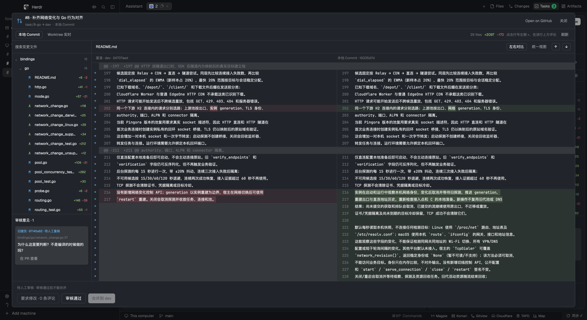

# Herdr 开发工作台

默认使用 **Shepherdr layout**：左边选项目，中间和 Assistant 对话或查看终端，右边跟进任务、检查代码、逐行评论并审核合并。底部有 Magpie、Komari、Gitview、Cloudflare、TAPD 和 Map 的常驻入口。

界面按参考图使用深青色毛玻璃效果：半透明底配合原生窗口模糊、半透明侧栏和圆角面板，背后内容呈现模糊轮廓，文字和代码保持清晰。配色和透明度保存在 `layouts/shepherdr.json`，随配置同步。

Kanso layout 已移除，工具已接入 Shepherdr。下面的截图来自实际运行的原生界面。


## 界面怎么分工

| 位置 | 用途 |
| --- | --- |
| 左侧 Spaces | 选择项目和机器。开始前先核对项目，避免在错误仓库里下任务。 |
| 中间 Assistant / 任务标签 | 给 Assistant 需求、补充限制、回答问题；在 Chat / Terminal 间查看聊天和命令输出。 |
| 右上角 Tasks | 查看任务、需要你处理的问题和待审核结果。点任务后可切换 Chat、Terminal、Pull request、Artifacts、Browser。 |
| 右上角 Files / Changes | 浏览当前项目文件和工作目录改动。审核某个任务时，进入该任务的 Pull request。 |
| 右上角 Artifacts | 查看项目成果；任务内的 Artifacts 聚焦单个任务的报告、证据和预览。 |
| 底部工具栏 | 打开辅助工具，再点同一入口可以收起；点 Tasks 等按钮可切回任务。 |

## 一次开发怎么走

### 1. 选项目，在 Assistant 里说明需求

先在左侧选中项目，打开它的 **Assistant**。把目标、验收条件、分支要求和限制说清楚。例如：

```text
给下载列表增加按状态筛选。
普通开发，目标分支 dev。
保留现有分页；切换筛选后回到第一页。
完成实现和相关验证，准备好让我在 Pull request 面板审核，先不要合并。
```

Assistant 分类并安排任务，Worker 在任务分支和 worktree 内实现。整体需求继续和 Assistant 说；单项实现细节可以在 Tasks 中打开对应任务的 Chat 补充。

业务仓库遵守这些分支规则：

- **普通需求、重构、开发阶段修复**：从 `dev` 创建分支，审核后合并回 `dev`。
- **修复 main 已有 bug**：明确说“修复 main 上的 bug”，从 `main` 创建修复分支，审核后合并回 `main`。
- **正式发布**：只有你明确说“上线”，才安排 `dev` 到 `main`、tag 或生产部署。

本配置仓库自身只用 `main` 自动同步，与业务仓库的开发分支分开。

### 2. 在 Tasks 跟进任务

点右上角 **Tasks** 看任务列表。`Working` 表示执行中；`Ready` 表示实现和规定的检查完成，等待你处理；`Needs you` 表示有问题、阻塞或待处理事项。


打开一项任务：

- **Chat**：读实现说明、验证结果和阻塞原因，补充任务要求。
- **Terminal**：检查实际命令和运行输出。
- **Pull request**：看本地 Diff、评论记录和人工审核状态。
- **Artifacts**：查看报告、证据和预览。

`Ready`、测试通过或开发阶段的模型评审通过，都不表示代码已经合并。

### 3. 打开 Pull request，检查实际代码

进入任务的 **Pull request**，点 **查看 Diff / 查看 Diff 并审核** 展开。左边是可搜索、可折叠的文件树，点文件查看带语言高亮的代码。



| 范围 | 适用场景 |
| --- | --- |
| **本地 Commit** | 审核已提交代码。读取本地任务提交和目标分支的差异，人工通过也绑定这个版本。 |
| **Worktree 实时** | 开发中查看未提交、未跟踪文件等现场改动；此范围不能通过审核或合并。 |

修改文件可以并排比较；整份新增、删除文件使用全宽视图。Diff 的打开和刷新直接读取本地 Git，不依赖 GitHub 拉取代码差异。

### 4. 点行旁边的 + 评论，再要求修改

1. 在 **本地 Commit** 中找到问题行，点最左侧行号旁的 **`+`**。
2. 编辑框出现在该行上方的左侧。普通代码点击不会打开评论。
3. 写清问题和预期，保存评论。
4. 可以在多个文件、多行分别保存意见。
5. 检查完后点 **要求修改 · N 条评论**，一次性把当前意见交给 Worker。

例如：

```text
筛选变化后需要把 page 重置为 1。
请检查请求参数和空列表展示，并补充对应验证。
```

**保存评论**先保存本地草稿；**要求修改**才提交本轮意见、撤销旧的通过状态并让 Worker 继续处理。已提交的人工意见会同步到对应 GitHub PR 的讨论区，包含原文、文件、行号和原提交引用；不是模型代写的新意见。

Worker 提交新版本后，原评论仍保留在左侧 **审核意见** 中，以 **旧提交 / 待人工复核** 标明。文件或行离开当前 Diff，也不会把评论隐藏或删除。同步成功后可以点 **在 PR 查看**；同步失败会明确提示，原文仍保留，可以重试。

### 5. PR 阶段只由你审核

开发阶段沿用设置中的模型评审要求。**任务进入 PR 阶段后，commit、push 和按意见返修不再触发模型评审，也不会因模型评审轮数耗尽而挡住返修。** Worker 完成规定检查、提交推送并回应评论后，回到 `Ready` 等你复核。

确认目标分支、代码、检查结果和意见处理情况后：

1. 在 **本地 Commit** 点 **审核通过**。
2. 再点 **合并到 dev / main**，以按钮显示的实际目标为准。
3. 等待操作成功。排队或等待合并不等于已合并。

审核绑定具体提交。审核后代码或目标分支版本变化，需要重新审核；有未提交改动等情况时会禁用操作并提示原因。Worker 不能替你通过人工审核。

## 辅助面板怎么用


| 面板 | 开发时的用途 | 本机依赖 |
| --- | --- | --- |
| Magpie | 看用量、配额，以及本机技能、MCP 等资源目录。 | 本机 Magpie 网关。 |
| Komari | 看节点状态和资源情况，辅助排查环境问题。 | 现有只读探针接口。 |
| Gitview | 检查当前项目的工作目录改动；任务人工审核在任务的 Pull request 完成。 | 本机 Gitview 执行文件，由引导模块安装。 |
| Cloudflare | 查看和管理已有账号连接的 DNS。 | 本机连接和凭据。 |
| TAPD | 看分配给自己的 Bug 和详情，给开发任务补充问题背景。 | 本机 TAPD 账号连接。 |
| Map | 查看 Agent 的工作进度图。 | 启动相关功能需要 Node.js / npx。 |

工具与任务共用右侧面板，切换工具不会替换或删除 Tasks、PR 和 Artifacts 的结构。

Artifacts 适合放实现说明、测试报告、截图和可交互预览，供审核时查看。产生 Artifact 不代表测试一定通过，也不代表代码已经合并。


## 模型设置和快捷键

左下角 **Settings** 打开 Herdr 设置，**Shepherdr** 打开任务系统设置。在 **Agents** 中选择 Worker、Reviewer 和 **Decision model · 决策模型**。

决策模型负责分类需求和辅助选择执行路线，Worker 实现代码，Reviewer 用于开发阶段的模型评审。PR 阶段由你人工评审。设置通常作用于后续新任务，运行任务沿用其 brief；PR 阶段的人工评审规则由同步的 Git 工作流策略统一生效。

Codex 模型目录读取本机配置，支持 `model_catalog_json` 和 `CODEX_HOME`；每台电脑分别维护自己的模型、账号和凭据。

| macOS 快捷键 | 操作 |
| --- | --- |
| `⌘⇧M` | 打开 / 收起 Magpie |
| `⌘⇧G` | 打开 / 收起 Gitview |
| `⌘G` | 打开 Gitview 独立标签 |
| `⌘B` | 显示 / 隐藏侧栏 |
| `⌘⇧P` | 命令面板 |
| `F2` / `⇧F2` | 重命名标签 / 项目空间 |

## 新 Mac 安装和自动同步

先安装 Herdr、Git 和系统 Python 3，配置此私仓访问权限，登录要使用的 Codex 或 Claude。在目标目录不存在时，**首次启动 Herdr App 前**执行：

```sh
git clone --branch main git@github.com:Kotodian/herdr-app-config.git ~/.config/herdr-app
```

然后打开 Herdr App。引导模块会选择 Shepherdr，安装本机 Gitview，初始化独立同步 checkout，注册登录时及每 5 分钟执行的自动同步，并从 `integrations/shepherdr/` 安装辅助命令、hooks 和服务；安装器处理需要的 Bun。

已有配置时先备份，不要直接覆盖。Magpie、Cloudflare、TAPD 的账号连接需要在各台电脑分别配置。

- **同步 ✓**：上次成功；点击可以立即同步。
- **同步中 / 待同步**：正在处理，或有更新等待下一轮。
- **同步 !**：失败，需要检查原因；断网恢复后会重试。
- 同步布局、主题、键位、自定义面板、README 截图和 Shepherdr 发行文件。
- 任务、聊天、worktree、登录、凭据、终端会话和窗口状态留在各自机器。
- 两边内容冲突时停止覆盖并保留双方；删除差异需要明确处理。

排查位置：

```text
状态：~/.config/herdr-app-sync/native-status.json
日志：~/Library/Logs/HerdrAppSync.log
传输 checkout：~/.config/herdr-app-sync/repository
应用前备份：~/.config/herdr-app/backups/github-sync-时间戳/
```

一般不需要手动操作传输 checkout。不要用强制拉取覆盖正在使用的 App 配置。
