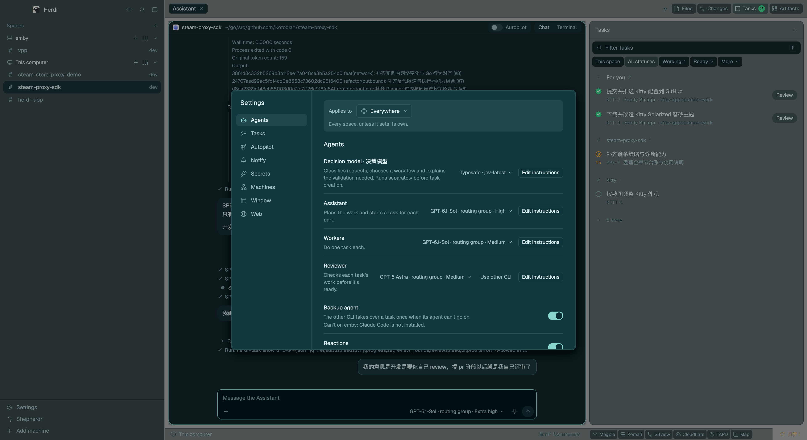
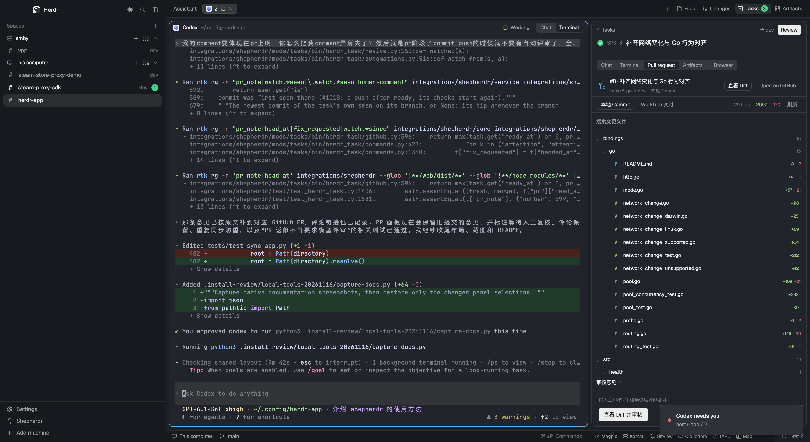
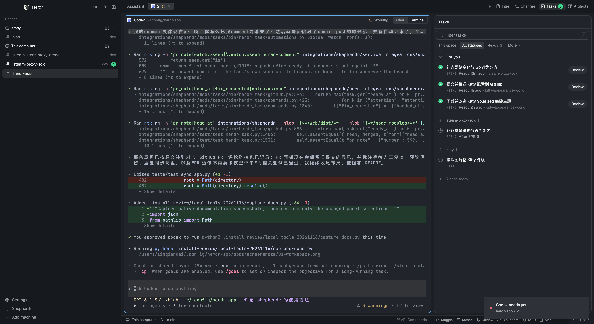
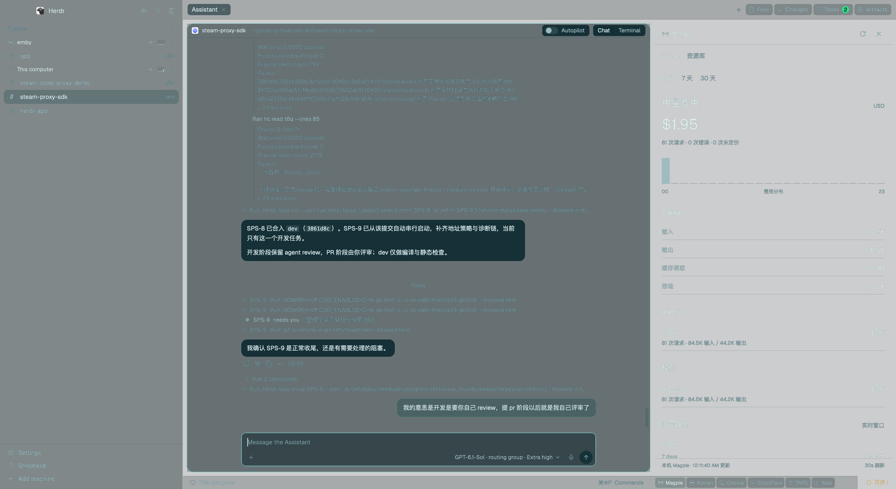
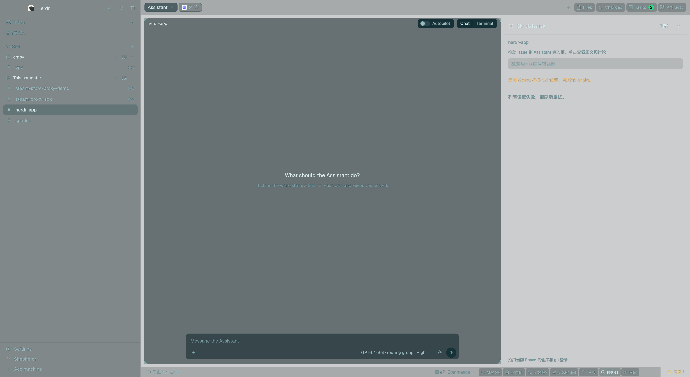
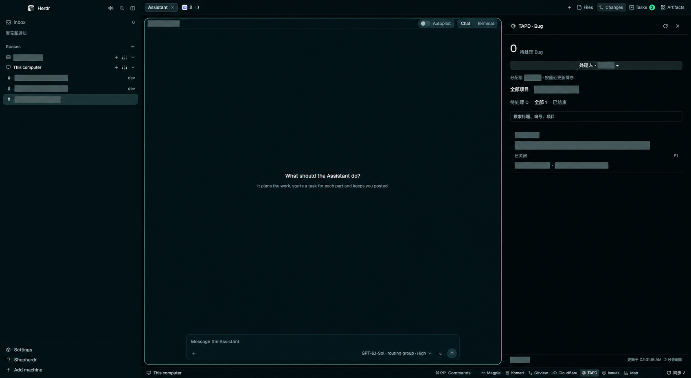
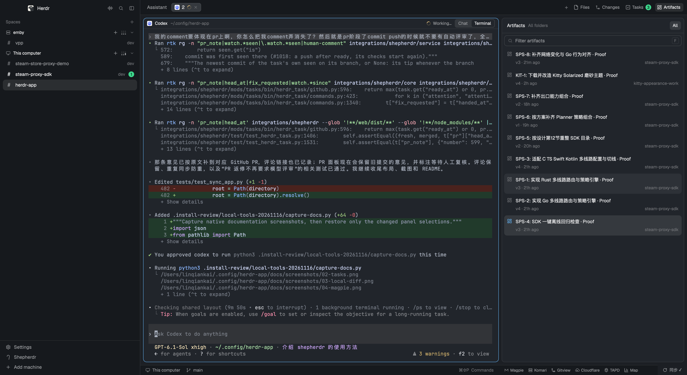

# Herdr 开发工作台

这套配置把 Assistant、任务、代码审核、通知和辅助面板放进 Herdr。第一次使用请按顺序完成：**安装 Herdr App → 导入工作台 → 设置角色模型 → 打开项目 → 开发与人工审核**。

## 1. 安装 Herdr App

到 [Herdr 官方下载页](https://herdr.dev/download/) 下载桌面 App；macOS Apple Silicon 可使用官网的 [最新版 DMG](https://releases.herdr.dev/app/Herdr.dmg)，下载后打开 DMG，将 Herdr App 放入「应用程序」。其他系统或架构以官网当前提供的安装方式为准。

官网也提供终端安装方式，适合需要一并安装 `herdr-app`、`hc` 等命令的环境：

```sh
curl -fsSL https://releases.herdr.dev/app/install.sh | sh
```

## 2. 导入工作台配置

安装 Git 和系统 Python 3，配置此私仓访问权限，登录要使用的 Codex 或 Claude。在目标目录不存在时，**首次启动 Herdr App 前**执行：

```sh
git clone --branch main git@github.com:Kotodian/herdr-app-config.git ~/.config/herdr-app
```

然后打开 Herdr App。引导模块会选择 Shepherdr，安装本机 Gitview，初始化独立同步 checkout，注册登录时及每 5 分钟执行的自动同步，并从 `integrations/shepherdr/` 安装辅助命令、hooks 和服务；安装器处理需要的 Bun。

已有配置时先备份，不要直接覆盖。Magpie、Cloudflare、TAPD 的账号连接需要在各台电脑分别配置。

首次打开后选择 **Shepherdr** layout，确认左侧有 Spaces、左下角有 Shepherdr 设置入口、底部有工具栏，再继续设置模型。

## 3. 设置各个角色的模型

### 打开正确的设置入口

左下角有两个入口：**Settings** 设置 Herdr 的外观与窗口；旁边的 **Shepherdr** 设置任务、模型和角色。

1. 点左下角 **Shepherdr** 图标，进入 **Agents**。
2. 先看顶部 **Applies to**：选 **Everywhere** 设置所有项目的默认值；选某个 Space 只覆盖该项目。也可以从项目侧栏菜单打开 **Space settings…**。
3. 找到要改的角色，点击这一行右侧的模型按钮。决策模型未选时显示 **Choose model…**。
4. 在弹出的模型选择器中先选 **Codex / Claude**，再搜索并选择模型；需要时调整 **Reasoning**。支持的模型还会显示 **Fast**、**Permissions**。
5. 选择会自动保存。关闭选择器后，检查角色按钮显示的模型和推理强度。



### 四个角色各管什么

| Agents 中的角色 | 工作范围 | 怎么选 |
| --- | --- | --- |
| **Decision model · 决策模型** | 在任务创建前分类需求、建议流程和验证要求，例如普通开发走 `dev`，生产缺陷修复走 `main`。 | 独立设置 Agent 和模型，例如 `Codex → Typesafe → typesafe/jev-latest`。分类器不承担代码实现。 |
| **Assistant** | 你在项目 Chat 中对话的主助手；拆分需求、创建任务、协调 Worker，并在人工通过后执行合并。 | 选择能理解项目、处理工具调用和 Git 流程的模型。 |
| **Workers** | 每项任务实际执行实现、验证和提交的 Agent。 | 设置后续新任务使用的编码模型和推理强度。 |
| **Reviewer** | 开发阶段的模型评审。任务进入 PR 阶段后统一改为人工评审。 | 可独立选模型；显示 **Other CLI (Codex / Claude)** 时，表示沿用 Worker 之外的另一种 CLI 默认模型。 |

**Typesafe** 是模型厂商分组。选它时核对完整模型 ID，例如 `typesafe/jev-latest`；只切换 Codex / Claude 标签，并不等于已经选择了 Typesafe。模型清单读取这台机器的模型目录与提供商配置，账号和凭据需要在本机可用。

### 评审开关、项目覆盖和运行中的任务

- **Reviewer 的模型**在 **Agents** 设置；是否开启开发阶段评审、最多几轮、必须修复的严重级别，在 **Tasks** 中设置 **Review rounds / Must fix**。选了 Reviewer 模型不等于打开评审。
- 项目行显示 **Inherited from Everywhere** 时，使用全局默认；显示 **Set for this space · Reset** 时，这个项目有覆盖。点 **Reset** 恢复继承。
- 新的角色默认值用于后续任务；运行中的任务保留创建时的 brief。修改默认值不会悄悄重启所有 Agent。
- 要切换**当前这段对话**的模型，点 Chat 输入框旁的模型按钮，选择新 Agent / 模型并按界面提示切换；不要只改全局默认后期待现有会话立即变化。
- PR 阶段的人工审核策略始终适用：提交、推送、按评论返修不会再触发模型自动评审。

### 模型没有出现在列表时

先确认该模型在当前机器的 Codex 或 Claude 中可用，再重新打开 Shepherdr 设置。Codex 的模型目录支持 `model_catalog_json` 和 `CODEX_HOME`；自定义提供商仍需要对应的本机 endpoint 和认证。Magpie 面板可以查看资源，但不代替这两种 Agent 的模型配置。每台电脑分别维护自己的模型、账号和凭据。

## 4. 打开项目，认识工作区

在左侧 **Spaces** 选择已有项目，或用 `+` 新建 Space 并选择项目仓库目录。确认当前 Space 的目录和机器后，打开它的 **Assistant**；任务、Issue 列表和代码检查都以这个项目为上下文。

默认使用 **Shepherdr layout**：左侧看 Inbox 和项目，中间使用 Assistant，右侧跟进任务和审核代码。深青色毛玻璃的配色和透明度保存在 `layouts/shepherdr.json`，随配置同步。本文界面截图的主工作区均使用 **Chat 模式**。



| 位置 | 用途 |
| --- | --- |
| 左侧 Inbox | 直接列出有新回复、待处理问题、Agent 通知和待人工审核的 session，显示会话名、所属项目和通知原因。同一会话合并显示，点击条目跳到对应会话；点右侧 `×` 关闭这次提醒，任务仍保留在 Tasks。新回复、新通知或再次提交审核时会重新出现。 |
| 左侧 Spaces | 选择项目和机器。开始前先核对项目，避免在错误仓库里下任务。 |
| 中间 Assistant / 任务标签 | 给 Assistant 需求、补充限制、回答问题；在 Chat / Terminal 间查看聊天和命令输出。 |
| 右上角 Tasks | 查看任务、需要你处理的问题和待审核结果。点任务后可切换 Chat、Terminal、Pull request、Artifacts、Browser。 |
| 右上角 Files / Changes | 浏览当前项目文件和工作目录改动。审核某个任务时，进入该任务的 Pull request。 |
| 右上角 Artifacts | 查看项目成果；任务内的 Artifacts 聚焦单个任务的报告、证据和预览。 |
| 底部工具栏 | 打开辅助工具，再点同一入口可以收起；点 Tasks 等按钮可切回任务。 |

## 5. 完成一次开发和人工审核

### 1. 选项目，在 Assistant 里说明需求

先在左侧选中项目，打开它的 **Assistant**。把目标、验收条件、分支要求和限制说清楚。例如：

```text
给下载列表增加按状态筛选。
普通开发，目标分支 dev。
保留现有分页；切换筛选后回到第一页。
完成实现和相关验证，准备好让我在 Pull request 面板审核，先不要合并。
```

Assistant 分类并安排任务，Worker 在任务分支和 worktree 内实现。整体需求继续和 Assistant 说；单项实现细节可以在 Tasks 中打开对应任务的 Chat 补充。

输入框下方的 **`+`** 可以添加本地文件、**GitHub Issue** 和**飞书文档**。GitHub Issue 直接列出当前 Space 仓库的开放 Issue，可以搜索后选择；飞书粘贴 `/docx/` 文档或 `/wiki/` 知识库链接，点「添加」读取。也可以从底部 **Issues**、**TAPD** 面板点「加入 Assistant」，将问题加入当前 Space 的 Assistant 草稿。附件会先留在输入框，和下一条消息一起发送；可点击预览、点击 `×` 移除。

业务仓库遵守这些分支规则：

- **普通需求、重构、开发阶段修复**：从 `dev` 创建分支，审核后合并回 `dev`。
- **修复 main 已有 bug**：明确说“修复 main 上的 bug”，从 `main` 创建修复分支，审核后合并回 `main`。
- **正式发布**：只有你明确说“上线”，才安排 `dev` 到 `main`、tag 或生产部署。

本配置仓库自身只用 `main` 自动同步，与业务仓库的开发分支分开。

**Debugger**

- In **Settings → Agents → Debugger**, choose the Codex model and reasoning level or edit the diagnosis instructions.
- In the project's **Assistant** chat, click **Debugger** to add a diagnosis request to the draft. Include the symptoms, reproduction steps, and affected version, then send it. Once the Assistant confirms the defect affects `dev` or `main` and starts the read-only Debugger, it appears above the message box.
- Debugger returns the diagnosis and proof to the Assistant. The Assistant publishes the proof and passes its link to the responsible Worker, who fixes and verifies the issue. For defects confined to other branches, the responsible Worker handles diagnosis, repair, and verification.

### 2. 在 Tasks 跟进任务

点右上角 **Tasks** 看任务列表。`Working` 表示执行中；`Ready` 表示实现和规定的检查完成，等待你处理；`Needs you` 表示有问题、阻塞或待处理事项。



打开一项任务：

- **Chat**：读实现说明、验证结果和阻塞原因，补充任务要求。
- **Terminal**：检查实际命令和运行输出。
- **Pull request**：看本地 Diff、评论记录和人工审核状态。
- **Artifacts**：查看报告、证据和预览。

`Ready`、测试通过或开发阶段的模型评审通过，都不表示代码已经合并。

### 3. 打开 Pull request，检查实际代码

进入任务的 **Pull request**，点 **查看 Diff / 查看 Diff 并审核** 展开。左边是可搜索、可折叠的文件树，点文件查看带语言高亮的代码。


| 范围 | 适用场景 |
| --- | --- |
| **本地 Commit** | 审核已提交代码。读取本地任务提交和目标分支的差异，人工通过也绑定这个版本。 |
| **Worktree 实时** | 开发中查看未提交、未跟踪文件等现场改动；此范围不能通过审核或合并。 |

修改文件可以并排比较；整份新增、删除文件使用全宽视图。Diff 的打开和刷新直接读取本地 Git，不依赖 GitHub 拉取代码差异。

### 4. 点行旁边的 + 评论，再要求修改

1. 在 **本地 Commit** 中找到问题行，点最左侧行号旁的 **`+`**。
2. 编辑框出现在该行上方的左侧。普通代码点击不会打开评论。
3. 写清问题和预期，保存评论。
4. 可以在多个文件、多行分别保存意见。
5. 检查完后点 **要求修改 · N 条评论**，一次性把当前意见交给 Worker。

例如：

```text
筛选变化后需要把 page 重置为 1。
请检查请求参数和空列表展示，并补充对应验证。
```

**保存评论**先保存本地草稿；**要求修改**才提交本轮意见、撤销旧的通过状态并让 Worker 继续处理。审核通过时也会提交当前草稿。带文件和行号的人工意见会作为 GitHub PR 的 **行内 Review comment** 发布，绑定评论时的提交、文件、行号和左右侧，原文保留在对应代码线程中。只有没有代码位置的整体意见才发布到 PR 讨论区。

Worker 提交新版本后，原评论仍保留在左侧 **审核意见** 中，以 **旧提交 / 待人工复核** 标明。文件或行离开当前 Diff，也不会把评论隐藏或删除。

- 点意见下的 **文件路径:行号**，打开评论原提交的 Diff 并滚动到对应行；原提交视图只读。
- 点 **标记已解决**，同步解决 GitHub 对应 Review thread；需要继续讨论时点 **重新打开**。审核通过不会偷偷把旧意见全部标为已解决。
- 点 **在 PR 查看**，打开 GitHub 上的评论位置。
- 点 **同步评论**，重试发布已提交的意见并同步线程状态。失败会显示原因，原文仍保留；行位置无效时不会改发成普通 PR 评论。

### 5. PR 阶段只由你审核

开发阶段沿用设置中的模型评审要求。**任务进入 PR 阶段后，commit、push 和按意见返修不再触发模型评审，也不会因模型评审轮数耗尽而挡住返修。** Worker 完成规定检查、提交推送并回应评论后，回到 `Ready` 等你复核。

确认目标分支、代码、检查结果和意见处理情况后：

1. 在 **本地 Commit** 点 **审核通过**。
2. 系统保存对当前提交的人工通过状态，自动通知该项目的 **Assistant** 执行合并，无需再点合并按钮。
3. 在 Chat 看 Assistant 报告的结果：已合并、等待检查、进入队列，或具体阻塞原因。排队、已交给 Assistant 都不等于已合并。

Assistant 暂时未启动或正在接收输入时，交接请求会保留并自动重试。审核绑定具体提交：执行合并时仍核对本地和远端的提交及目标分支；审核后代码或目标分支版本变化，需要重新审核。有未提交改动等情况时会禁用通过操作并提示原因。Worker 不能替你通过人工审核。

## 6. 使用 Issues、TAPD 和其他辅助面板



| 面板 | 开发时的用途 | 本机依赖 |
| --- | --- | --- |
| Magpie | 看用量、配额，以及本机技能、MCP 等资源目录。 | 本机 Magpie 网关。 |
| Komari | 看节点状态和资源情况，辅助排查环境问题。 | 现有只读探针接口。 |
| Gitview | 检查当前项目的工作目录改动；任务人工审核在任务的 Pull request 完成。 | 本机 Gitview 执行文件，由引导模块安装。 |
| Cloudflare | 查看和管理已有账号连接的 DNS。 | 本机连接和凭据。 |
| TAPD | 选择处理人后跨项目看 Bug，更新状态、转交处理，或点「加入 Assistant」。 | 本机 TAPD 账号、项目成员及相应读写权限。 |
| Issues | 列出当前 Space 仓库的开放 Issue，搜索、查看正文和讨论，点「加入 Assistant」。 | 仓库的 GitHub `origin`、该机器的 `gh` 登录。 |
| Map | 查看 Agent 的工作进度图。 | 启动相关功能需要 Node.js / npx。 |

工具与任务共用右侧面板。**导入布局只会安装面板，不会替你安装 Magpie、创建云账号或复制登录凭据。** 按需完成下面的首次配置，配置好一个就打开对应面板验证。

### Magpie：连接本机网关和资源库

1. 先在本机安装、启动你使用的 Magpie，在 Magpie 中配置自己的提供商、账号和资源库，并启用本机网关。
2. 此面板默认读取 `http://127.0.0.1:3425`。在终端运行下面的只读请求，能返回 JSON 就说明用量接口可达：

   ```sh
   curl -fsS 'http://127.0.0.1:3425/v1/magpie/usage?period=today'
   ```

3. 点底部 **Magpie**，确认用量、配额能加载；切换资源库，确认技能、MCP、子代理和指令列表。资源目录读取 `~/.config/magpie/library.json`，技能正文来自 `~/.config/magpie/library/skills/`，需要先在 Magpie 中添加相应资源。
4. 提示网关离线时先启动 Magpie；用量正常但资源库报错时检查资源库文件是否存在。使用其他端口时，修改 `mods/local-magpie/main.js` 顶部的 `GATEWAY` 后刷新。每台电脑分别设置 Magpie，面板不会替 Codex / Claude 配置模型认证。

### Komari：接入自己的探针站点

1. 先准备已有的 Komari 服务端及节点探针，确认浏览器能访问自己的站点。
2. 编辑 `mods/local-komari/main.js` 顶部的 `BASE`，改成自己的站点地址，保留协议且不带结尾 `/`。当前随配置保存的是原有站点，换用自己的部署时需要改这里。
3. 当前面板读取 `/api/nodes`、`/api/rpc2` 的 `common:getNodesLatestStatus`，以及节点的 `/api/recent/<uuid>`。站点需要允许这些只读接口；面板目前没有登录或 API Token 输入框，要求登录的私有站点需先适配认证。
4. 点底部 **Komari**，看到节点、在线状态和资源数据即配置成功，数据约每 10 秒刷新。只有空列表时先核对服务端是否已收到探针；请求失败时检查地址、网络及接口权限。

### Gitview：安装本机 Git 引擎

1. 本机先有 Git。首次导入工作台时，引导模块会安装与 macOS 架构匹配的 Gitview，并生成本机的 `mods/gitview/config.json`，其中记录 `bin`、`herdr_app`、`hc` 路径。
2. 若底部 **Gitview** 提示未安装，在本机终端执行工作台自带的安装命令：

   ```sh
   python3 ~/.config/herdr-app/sync-app.py runtime
   ```

3. 在一个有 Git 提交记录的项目 Space 打开 Gitview，确认分支、历史和工作目录差异可见。配置中的绝对路径由本机生成，换电脑后重新安装；不要从旧电脑复制执行文件路径。远端项目还需要对应 Herdr 机器连接可用。

### Cloudflare：配置 DNS 访问权限

1. 在 Cloudflare 为要管理的域名创建 API Token，授予读取域名和 DNS 记录的权限；需要在面板新建或修改记录时，再授予对应域名的 DNS 编辑权限。
2. 在本机 Magpie 的 MCP 资源中配置名为 **`cloudflare-mcp-pro`** 的连接，将 Token 填入环境变量 **`CLOUDFLARE_API_TOKEN`**。桥接程序从 `~/.config/magpie/library.json` 的 `mcp` 列表读取这个连接的 `env.CLOUDFLARE_API_TOKEN`，名称和字段需匹配。
3. 点底部 **Cloudflare**，能列出授权域名并展开 DNS 记录即读取成功。看不到域名时检查 Token 的资源范围；能看不能保存时检查编辑权限。更新凭据后刷新面板即可，桥接每次请求都会重新读取。
4. 新电脑需要重新配置此连接。工作台同步不携带 Magpie 的 Token。

### GitHub Issue：选择、加入 Assistant 和监听

首次使用先在**仓库所在的机器**安装 GitHub CLI 并登录，再到项目仓库目录检查：

```sh
gh auth login
gh auth status
git remote get-url origin
```

`origin` 应指向你要处理的 GitHub 仓库。尚未设置时，用自己的地址执行 `git remote add origin git@github.com:OWNER/REPO.git`；已有但地址错误时用 `git remote set-url origin ...` 修改。确认 Space 打开的是这个仓库目录，再点 **Issues → 刷新**。显示仓库名和 Issue 列表、或正常的零条空状态即接入成功；“未配置 origin”和权限错误需要先修好仓库或登录。远端 Space 要在远端完成这些步骤。



1. 在左侧选中项目 Space。**Issues** 面板和 `+ → GitHub Issue` 使用这个 Space 文件夹的 GitHub `origin`，无需选择项目或另设绑定；切换 Space 后列表跟随切换。
2. 在仓库所在机器安装 GitHub CLI，执行 `gh auth login`，确认 `gh auth status` 正常并具有仓库权限。远端 Space 使用远端机器的 Git 和 `gh`。
3. 点底部 **Issues**，搜索编号或标题。单击 Issue 查看正文和讨论；在列表卡片或详情页点「加入 Assistant」，会读取完整内容并加入当前 Space 的 Assistant 草稿。请先打开该 Space 的 Assistant 聊天并等待草稿就绪。也可从 `+ → GitHub Issue` 直接点选。列表只显示开放 Issue，Pull Request 不混入列表；点「刷新」重新读取。
4. 发消息时说明要求，例如“根据这个 Issue 排查并创建修复任务”。读取和加入草稿不会自动发消息、创建任务或修改 GitHub。
5. 要持续监听，打开此 Space Assistant 的 **Autopilot** 开关。现有后台调度器会约每分钟检查 Issue 的新增和更新（含讨论和状态变化），合并重复提醒，等 Assistant 空闲且你没有正在输入时再交给它处理。首次启用或切换仓库先建立基线，不把历史 Issue 批量唤醒；监听期间关闭 Autopilot 就停止检查。读取失败会保留进度，恢复后重试。
6. 要关闭 Issue，打开它的详情，点 **关闭 Issue**，选择 **已完成** 或 **不再计划**，再点 **确认关闭**。操作写入当前 Space 对应的 GitHub 仓库，成功后从开放列表移除。需要当前 `gh` 登录具备 Issue 写入权限；失败时显示错误，刷新确认实际状态后再操作。

监听不会替你在 GitHub 评论、关闭 Issue 或通过 PR。后续动作遵守 Autopilot 的指令、任务分支规则和人工审核流程。

### TAPD：先选处理人，再查看和处理 Bug

首次接入需要 TAPD 账号有项目访问权限，并在本机配置个人访问令牌。macOS 推荐用「钥匙串访问」新建密码项目：项目 / 服务名称填 **`codex.tapd.access_token`**，账户填 **`default`**，密码填自己的 TAPD 个人令牌。面板会从钥匙串读取，不需要把令牌写进工作台目录。

也支持由 **Herdr App 进程环境**提供 `TAPD_ACCESS_TOKEN`，或同时提供 `TAPD_API_USER`、`TAPD_API_PASSWORD`。只在一个终端中 `export` 不会更新已经运行的桌面 App；应让 App 从带有这些变量的启动环境重新启动，或使用钥匙串方案。桥接会确认登录账号、读取其可访问项目的成员；默认查看自己，切换处理人后查询分配给所选成员的 Bug。

配置后点底部 **TAPD → 刷新**，看到当前处理人、参与项目和 Bug 列表即成功；显示零条也可能只是没有分配给自己的 Bug。有连接或项目错误时，先检查令牌、钥匙串授权和项目权限。换电脑需重新配置钥匙串或启动环境。



1. 点底部 **TAPD**，在列表顶部点 **处理人**，搜索并选择项目成员，然后查看**分配给这个人**的 Bug。默认是自己，还可按项目、是否结束和关键词筛选，每两分钟刷新。这里的处理人选择只改变查看范围。
2. 单击 Bug 卡片查看详情。需要处理它时，在 **更新状态 / 转交 Bug** 中选择目标状态或新的处理人，再点 **保存状态 / 转交**。状态选项来自当前项目、当前状态可用的流转规则；有流转必填项时补齐后保存。
3. 保存才会更新 TAPD。状态修改保留现有处理人，显式选择新处理人才转交；转交后从原处理人的列表移出。保存前会重新检查当前版本，别人已修改时要求先刷新；没有写入权限时显示错误。请为本机令牌配置缺陷更新和转交所需的项目权限。
4. 在列表卡片或详情页点「加入 Assistant」，会重新读取 Bug，生成包含编号、项目、状态、处理人、优先级、描述和 TAPD 原始链接的附件，加入当前 Space 的 Assistant 草稿。
5. 补充处理要求后发送。可以依次加入多个 Bug，也可以移除附件后再发；每条消息最多 20 个附件。

TAPD 不绑定项目 Space，也不需要配置项目映射。先切到目标 Space 并打开其 Assistant 聊天，等待草稿就绪，再点「加入 Assistant」。加入草稿不会自动发送消息、创建任务或修改 Bug；重复添加同一 Bug 不会产生第二份附件。凭据沿用本机 TAPD 连接；新电脑需要单独配置，令牌不随 Git 同步。Bug 不存在或失去项目权限时会报错，刷新面板后重试。

### Map：启动项目进度图

1. 在本机安装 Node.js，确认终端中的 `node --version`、`npx --version` 能执行。首次启动需要能访问 npm。
2. 先选中**本机 Git 项目中的终端**，再点底部 **Map** 和启动按钮。面板会新开 `Agenttrail Map` 标签，运行固定版本 `npx -y agenttrail@0.4.1 <仓库目录> --no-open`；保留这个进程运行。
3. 面板默认从本机 `5330–5344` 端口寻找匹配当前仓库的 Map。出现项目名、提交或任务卡片即成功；启动失败先看 `Agenttrail Map` 标签内的错误。有进程却没有卡片时检查仓库是否有提交；需要组件规划图时，在仓库执行 `npx agenttrail@0.4.1 init`。
4. 这个 mod 当前跟随本机终端的仓库，不会自动连接远端 Space 的 Map。自定义实例可在布局中 `agenttrail` 的 `content.props` 设置 `port` 或 `portBase`；新电脑需重新安装 Node.js 并启动自己的 Map 进程。

### Artifacts 和通知

Artifacts 适合放实现说明、测试报告、截图和可交互预览，供审核时查看。产生 Artifact 不代表测试一定通过，也不代表代码已经合并。

Artifacts、Inbox 和 Tasks 不需要额外账号连接，随 Shepherdr 安装。若这些核心面板缺失或服务未就绪，在本机运行 `shepherdr doctor` 查看安装情况。配置同步入口见下一节。



## 7. 自动同步和排查

工作台导入后会自动同步配置；每台机器的账号连接仍需单独设置。

- **同步 ✓**：上次成功；点击可以立即同步。
- **同步中 / 待同步**：正在处理，或有更新等待下一轮。
- **同步 !**：失败，需要检查原因；断网恢复后会重试。
- 同步布局、主题、键位、自定义面板、README 截图和 Shepherdr 发行文件。
- 任务、聊天、worktree、登录、凭据、终端会话和窗口状态留在各自机器。
- Herdr 生成的模组类型声明、编辑器配置和新任务 Artifact 留在本机。
- Shepherdr's Web build output stays local. Sync distributes the source, and each machine builds its own `web/dist`.
- 两边内容冲突时停止覆盖并保留双方；删除差异需要明确处理。

排查位置：

```text
状态：~/.config/herdr-app-sync/native-status.json
日志：~/Library/Logs/HerdrAppSync.log
传输 checkout：~/.config/herdr-app-sync/repository
应用前备份：~/.config/herdr-app/backups/github-sync-时间戳/
```

一般不需要手动操作传输 checkout。不要用强制拉取覆盖正在使用的 App 配置。

## 8. 常用快捷键

| macOS 快捷键 | 操作 |
| --- | --- |
| `⌘⇧M` | 打开 / 收起 Magpie |
| `⌘⇧G` | 打开 / 收起 Gitview |
| `⌘G` | 打开 Gitview 独立标签 |
| `⌘B` | 显示 / 隐藏侧栏 |
| `⌘⇧P` | 命令面板 |
| `F2` / `⇧F2` | 重命名标签 / 项目空间 |

