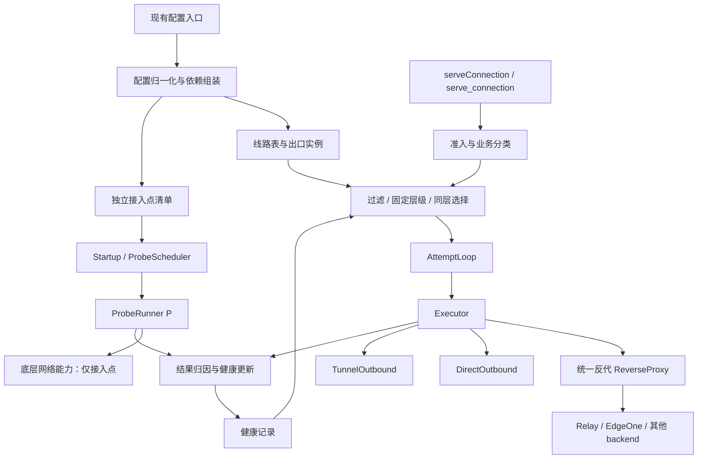
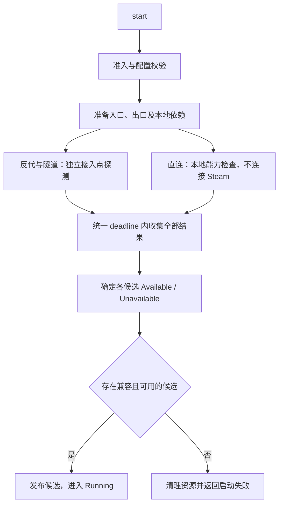

# Steam 商店加速 SDK 路由与策略引擎设计

> [!abstract] 设计边界
> 对外保留现有 Rust 配置、`start`、`serve_connection` 和 `close` 接口。切换增加一个 `restart(next_config, cancel)` 方法，由 SDK 内部关闭旧实例、创建新实例并启动。配置使用 Rust 类型。
>
> **CDN 与远端反代是同一个 `RemoteReverse<B>` 能力，区别在 backend。** A、B 是路由优先级，不是两套协议实现。固定顺序为 **A 中转节点反代 → B CDN 边缘反代 → C 优选 IP 直连 → D 加密隧道兜底**。
>
> 探测是独立的泛型能力，只检查接入点，不访问 Steam，不调用 outbound。`start` 结束前确定候选资格；线路只有 `Available` / `Unavailable`。

本文只设计 SDK，尚未实施。宿主继续负责连接接管、原始目标交付、系统设置和 CA 信任管理。

## 1. 代码依据

本次核对的主仓库为 `__HERDR_SYNC_HOME__/go/src/github.com/Kotodian/steam-store-proxy-demo`，主仓库提交 `3df06ec`；其 `rust/sdk` 是独立 Git 子模块，提交 `fdd883aae27b5534426dd1dd11aedd28946603d7`。以下路径均相对该主仓库。

| 代码位置 | 已有事实 | 设计据此衔接 |
| --- | --- | --- |
| `rust/sdk/src/config.rs`、`src/modes.rs` | `Profile<M>`、`ModeSpec`；`RemoteReverse<P>` 已将后端参数化；`RemoteBackend` 已包含 Relay、Cloudflare、EdgeOne 等 | 扩展现有配置数据，复用远端反代能力与 backend 身份 |
| `rust/sdk/src/lifecycle.rs` | `Factory::create(Profile<M>) -> Mode<M>`；`start`、`serve_connection`、`close`；已有 `DataPlaneFactory` 注入；尚无 restart | 保留这些方法，新增 restart 封装关闭、重建及启动 |
| `rust/sdk/src/native_plane.rs` | `Session` 持有单个 `Arc<Backend>`；`choose_backend` / `select_backend` 负责启动选择 | 抽离单出口假设，将资源准备、接入点探测和业务选择分开 |
| `rust/sdk/src/backend.rs`、`src/http_proxy.rs` | 多个 backend 已共用 HTTP 处理；`RemoteBackend::payload()` 区分 HTTP 与原始 TCP | 保留共享协议流程，拆出 backend 差异与出口能力边界 |
| `rust/sdk/src/policy.rs`、`src/http_proxy.rs::http_route` | 现有 `DomainRoute::Direct` 只参与本地反代路径的目标映射 | 不能据此宣称已有通用 C 类直连出口 |
| `rust/sdk/src/native_plane.rs::select_backend`、`src/http_proxy.rs::verify` | 启用旧验证选项时，会经业务 backend 验证配置中的 HTTP 目标；部分 backend 则不执行启动验证 | 本方案需替换为独立接入点探测，不能复用这条业务验证路径 |
| `rust/sdk/src/retry.rs`、`src/relay.rs` | 已有 TCP 建连重试与流生命周期处理 | 跨候选尝试共享预算，保留已建立流不重放的边界 |
| `rust/sdk/src/lifecycle.rs::start`、`close` | start 只能从 Created 进入；close 取消并等待旧资源关闭 | restart 必须创建新 Inner，不能复用已关闭实例的取消令牌 |
| `rust/sdk/bindings/go` | 独立纯 Go SDK | 需要按同一行为契约独立适配 |

代码中已经内置 Steam 白名单，默认启用 VLESS/XHTTP；旧笔记中相反的表述不作为本次设计依据。多线路调度、通用 C 类直连、HTTP 经 D 类隧道转发均需实际改造和验证。

历史背景：[[Steam 商店加速-SDK多客户端集成方案]]、[[Steam 商店加速-本地反代与多线路方案]]、[[Steam 商店加速-EdgeOne头部路由与亚太CM配置]]。这些笔记中的旧接口、旧部署及测试结果不代表当前代码已经具备本文能力。

## 2. 协议能力与路由优先级分开

SDK 组合三类出口能力：**远端反代、直连、隧道**。路由在这些能力上执行 A→B→C→D 的固定顺序。

| 路由顺序 | 使用的能力 | backend / 实现 |
| --- | --- | --- |
| A 中转节点反代 | `RemoteReverse<B>` | `Relay` backend |
| B CDN 边缘反代 | 同一个 `RemoteReverse<B>` | `EdgeOne`、`EdgeOneOrigin`、`CloudflareWorker` 等 backend |
| C 优选 IP 直连 | `DirectOutbound<S>` | 候选地址来源与地址选择策略 |
| D 加密隧道兜底 | `TunnelOutbound<T>` | 现有 `ForwardConfig` 表达的 VLESS/XHTTP、WebSocket、SS |

A、B 共同使用 `ReverseProxy<B>` 的连接、HTTP 转发、池化、流式响应和观测流程。`ReverseBackend` trait 表达接入域名、目标头、authority/SNI 映射等差异。backend 的预设归类决定 A 或 B，调用方不用填写优先级。

`EdgeOneWebSocket` 是现有远端反代配置中的 TCP 载荷 backend，仍按其真实载荷能力处理；不能因为同属 EdgeOne 就当成普通 HTTP backend。它与 `ForwardConfig` 下的 WebSocket 隧道保留各自现有配置含义。

选择先检查目标准入、协议能力与健康条件，再按固定顺序选第一个有候选的层级。同层节点先比较近期连接失败和建连耗时，再在表现接近的节点间使用稳定哈希分配。指标只影响同层选择，不能让 B 越过可用 A；具体算法见第 6 节。

同一次操作在 A1 建连失败后先尝试 A2；A 无可用候选才考虑 B，再到 C、D。已识别的下载流量跳过图中禁止承载下载的 CDN backend，其余候选保持原顺序。规则在发送请求前依据已知业务信息判断，不等待响应后重新解释这次路由。

## 3. 配置沿用现有入口

沿用 `Profile<M>` 和 `ModeSpec`，增加能表达候选集合的配置值 `Routes`。它通过 `From<Routes> for ModeConfig` 进入当前 `Factory::create`，保持现有创建入口。切换使用第 9 节新增的 restart。下面是**待实施的 Rust 配置示例**，`Routes` 当前尚未实现：

```rust
// 拟增加的配置数据；协议相关类型沿用现有实现。
#[derive(Clone)]
pub struct Routes {
    pub payload: Payload,
    pub reverse: Vec<modes::RemoteReverse>,
    pub direct: bool,
    pub tunnel: Vec<ForwardConfig>,
}

let config = Profile::new(
    "steam",
    Routes {
        payload: Payload::Http,
        reverse: vec![
            modes::RemoteReverse {
                backend: RemoteBackend::Relay,
                server_name: "relay.example.net".into(),
            },
            modes::RemoteReverse {
                backend: RemoteBackend::EdgeOneOrigin,
                server_name: "edge.example.net".into(),
            },
        ],
        direct: true,
        tunnel: vec![ForwardConfig::parse(node_url)?],
    },
    Whitelist::steam(),
);

let dependencies = Dependencies::new()
    .with_server_certificate_provider(signer);
let mut sdk = Factory::new(dependencies).create(config)?;
sdk.start(Default::default()).await?;
sdk.serve_connection(incoming).await?;
sdk.close().await?;
```

`reverse` 是统一反代列表，backend 明确指定，不按域名猜测供应商。`modes::RemoteReverse` 使用现有默认泛型参数 `RemoteBackend`，因此不同 backend 可以放进同一列表；静态协议实现仍可使用 `RemoteReverse<Relay>` 等已有类型。

`payload` 复用现有 `Payload`，描述入口交付 HTTP 还是原始 TCP。多出口以后，入口载荷不能再由某个单独 backend 推导。`configuration_policy()` 的 CA 要求也要按这个入口约定计算。

空列表表示不配置该能力；`direct: false` 表示不提供 C。所有候选均关闭、backend 所需 feature 未编译或入口载荷无兼容出口时，在配置阶段报错。旧单出口配置仍可归一化成单候选并沿用原调用方式。

配置只交付连接所需参数。固定顺序、探测并发与超时、冷却、防抖、同层分配和内部编号由 SDK 提供默认策略。白名单、证书供应器、宿主 dialer 和其他既有依赖继续复用。

Rust 继续使用创建配置 → `Factory::create` → `start` → `serve_connection` 的主流程。调用 restart 需要持有 SDK 的可变所有者；原有方法签名保留。

## 4. 内部职责拆分

| 模块 | 职责 | 主要输入与输出 |
| --- | --- | --- |
| 配置归一化 | 校验 backend、feature、入口载荷，展开候选并赋予固定层级 | 配置 → `Vec<Route>` |
| `Startup` | 准备资源，等待启动检查完成，统一发布可用候选 | 配置、资源、探测结果 → 启动结果 |
| `TrafficClassifier` | 从已准入目标和协议提取业务限制 | 请求元信息 → 协议、下载等判断 |
| `CandidateFilter` | 判断候选是否兼容、可尝试且未在本次失败 | `Route`、健康记录、本次尝试记录 → 是否保留 |
| `FixedTier` | 按 A→B→C→D 遍历 | 固定顺序 |
| `NodeSelector` | 在选中层级内分配节点 | 同层候选 → `RouteId` |
| `Planner<F, N>` | 组合过滤、固定顺序与同层选择 | 已准入流量 → `RouteId` |
| `AttemptLoop<E, O>` | 管理一次操作的 deadline、次数和下一候选 | 执行结果 → 继续或结束 |
| `Executor` | 执行指定候选并记录提交边界 | `RouteId`、业务输入 → 业务结果 |
| 出口资源管理 | 持有实例、连接池与生命周期 | `RouteId` → 指定出口实例 |
| `ReverseProxy<B>` | 统一远端反代流程，委托 backend 处理差异 | HTTP 业务 → 反代传输 |
| `DirectOutbound<S>` / `TunnelOutbound<T>` | 直连与隧道的连接行为 | 原始目标 → 对应传输 |
| `OutcomeClassifier` | 区分接入失败、目标失败、业务响应与取消 | 执行结果 → 可归因的反馈 |
| `HealthTracker` / `CircuitBreaker` | 更新统计，维护两态资格与冷却 | 反馈 → 健康记录变化 |
| `ProbeScheduler` | 管理探测时间、并发、去重与取消 | 已注册接入点 → 到期任务 |
| `ProbeRunner<P>` | 在 deadline 内调用独立探测能力 | `P::Target` → 测量结果 |

这些是模块和组合边界，不要求每个模块单独建 actor、线程或 crate。小的归因、层级遍历、统计函数可以保持同步；网络能力和可替换策略通过 trait 组合。

依赖关系如下。探测分支与业务出口分支只在启动组装和结果反馈处汇合：



## 5. 保留真实数据，直接借用

持久状态只由实际使用它的模块持有：

| 数据 | 内容与所有者 |
| --- | --- |
| `Vec<Route>` | 不可变候选描述：编号、固定层级、backend / 协议参数、能力；创建时生成 |
| 出口实例与连接池 | 出口资源管理持有；按指定编号取得，内部不重新选路 |
| `Health` | 每个接入点的可达性、业务失败记录、冷却时间和统计；健康模块更新 |
| `Attempt` | 本次操作的 deadline、已尝试节点、剩余额度及提交状态；`AttemptLoop` 持有 |
| 探测调度记录 | 到期时间、在途任务、取消信息；调度器持有 |
| SDK 生命周期与任务集合 | 沿用现有生命周期及任务管理 |

规划器直接借用这些数据，不为引用集合再建一批包装类型：

```rust
// 拟议内部接口。Traffic 表示已准入业务的目标与协议元信息。
struct Planner<F, N> {
    filter: F,
    nodes: N,
}

impl<F: CandidateFilter, N: NodeSelector> Planner<F, N> {
    fn select(
        &self,
        traffic: &Traffic,
        routes: &[Route],
        health: &Health,
        attempt: &Attempt,
    ) -> Result<RouteId> {
        for tier in [Tier::A, Tier::B, Tier::C, Tier::D] {
            let candidates: Vec<&Route> = routes.iter()
                .filter(|route| route.tier == tier)
                .filter(|route| self.filter.allows(
                    traffic, route, health, attempt,
                ))
                .collect();
            if let Some(id) = self.nodes.select(traffic, &candidates, health) {
                return Ok(id);
            }
        }
        Err(Error::NoAvailableRoute)
    }
}
```

以上错误和策略 trait 为拟议内部定义。Planner 只返回已选节点编号，不需要再包装一个仅含编号的计划对象。它不连接网络、不更新健康、不决定重试，也不拥有配置和连接池。

共享 `Health` 通过短时读写锁保护：选路期间借用读取，得到编号后释放读锁，再连接网络。执行前重新检查该候选是否仍可使用；已失效则回到本次选择流程。统计与熔断在同一条记录中原子更新，避免保存两套计数。

## 6. 探测是独立的 trait 能力

探测模块不导入 `Outbound`、`Backend`、`Route` 或业务请求类型。它只认识目标、网络能力和测量结果：

```rust
use std::{future::Future, sync::Arc, time::Duration};

pub(crate) trait Probe: Send + Sync {
    type Target: Send + Sync;

    fn probe<'a>(
        &'a self,
        target: &'a Self::Target,
    ) -> impl Future<Output = Result<Duration>> + Send + 'a;
}

// 真正需要连接的接入地址，不包含 Steam 目标、路径或业务头。
struct SocketEndpoint {
    host: String,
    port: u16,
}

struct TcpProbe<D: ?Sized> {
    dialer: Arc<D>,
}

impl<D: TcpDialer + ?Sized> Probe for TcpProbe<D> {
    type Target = SocketEndpoint;

    async fn probe(&self, target: &SocketEndpoint) -> Result<Duration> {
        let started = std::time::Instant::now();
        let stream = self.dialer.connect(&target.host, target.port).await?;
        drop(stream);
        Ok(started.elapsed())
    }
}

struct ProbeRunner<P> {
    probe: P,
    timeout: Duration,
}
```

`ProbeRunner<P>` 在调用外层统一处理超时、取消和并发预算；取消时丢弃并等待受控任务退出。实现不得留下脱离生命周期的网络任务。调度器决定何时探测，探测实现决定怎样测量，健康模块决定怎样使用结果。

默认实现只连到接入点 TCP 端口并关闭。以后需要 TLS 握手探测时，可以新增 `Probe` 实现，仅验证接入点自身的 TLS 身份。普通 CDN 根路径也可能回源，因此不发送 HTTP GET、HEAD 或业务健康检查请求。

组装层从配置分别生成出口实例和接入点清单：

```text
反代配置：server_name / 接入端口 ──→ SocketEndpoint ──→ ProbeRunner
隧道配置：节点 server / port     ──→ SocketEndpoint ──→ ProbeRunner
反代 / 隧道协议配置             ──→ 对应业务出口实例
```

映射接入点与线路编号的关系由组装及反馈层持有。`Probe` 本身不需要线路编号，也不要求 outbound 提供 `probe()`、`health_check()` 或探测连接。

探测和业务可以共享现有底层 `TcpDialer` 注入，但调用的目标只能是配置中的接入地址。禁止通过 SDK 的业务 `connect`、隧道连接或选路器完成探测。宿主提供的底层 dialer 需遵守这一目标边界。

| 候选 | 主动探测范围 | 能证明什么 |
| --- | --- | --- |
| A / B 远端反代 | 对应 backend 的接入地址 | 接入点能否建立连接 |
| D 隧道 | 隧道服务器地址 | 节点入口能否建立连接 |
| C 直连 | 不发起原站主动探测 | 只验证本地配置和能力准备；性能与成功率来自真实业务 |

TCP 成功不能证明反代回源成功、隧道认证成功或 Steam 可访问。接入探测成功不能清除业务 429、原站故障、证书或凭据错误。

### 6.1 一次探测具体做什么

1. 读取已经注册的接入地址，例如 `relay.example.net:443`，通过宿主底层 dialer 解析和连接。
2. 从调用 dialer 前开始计时；连接建立后停止计时并立即关闭流，不发送应用数据。
3. 成功记录耗时和完成时间；失败记录 DNS、拒绝、超时等原因。整个调用受 ProbeRunner 的统一 deadline 和取消约束。
4. 由反馈层把测量更新到使用该接入点的线路健康记录，探测实现本身不知道业务线路。

当前示例计量的是 `dial_elapsed`：可能包含 DNS、地址轮换和 TCP 建连。它表示这次建立接入连接的成本，**不能直接称为网络 RTT**。当前 `TcpDialer::connect_observed` 已支持阶段观测，内建 dialer 可以分开记录 Resolve / Connect；自定义 dialer 未提供细分时，只记录总耗时，不补造 TCP RTT。

相同接入地址、网络 generation 和探测实现的在途任务可以去重。不同 backend 可以共享接入可达性证据，业务协议、凭据及目标失败仍分别记录。

### 6.2 何时探测，以及怎样判断健康

以下为待实现的内部初值，不增加 SDK 配置字段：

| 时机 | 行为与判断 |
| --- | --- |
| Start | 每个接入点执行一次有界探测；成功则具备接入资格，失败或超时则不具备 |
| 正常运行 | 约每 15 秒探测，加入 ±20% 抖动；全局并发上限 3，同一接入点最多一个在途任务，单次最多 3 秒 |
| 暂时失败 | 单次失败降低该节点的同层偏好；连续 3 次接入失败后记为 Unavailable |
| 已不可用 | 探测间隔按 15、30、60 秒退避，最高 120 秒；不接收普通业务 |
| 恢复检查 | 首次成功后以约 15 秒间隔复查；连续两次成功恢复接入资格，中途失败重新累计 |
| 测量过期 | 正常候选超过 60 秒没有有效接入证据时，不继续沿用旧资格，等待新的检查结果 |

真实业务中能明确归因到接入点的 DNS / TCP 失败也参与接入健康判断，逻辑建连结果只结算一次；内部 TCP 重试不能重复计数。接入成功可以更新对应证据，目标 HTTP 结果不会被算成接入成功率。

### 6.3 指标怎样进入选路

| 指标 | 来源与作用范围 | 首版用途 |
| --- | --- | --- |
| 连续接入失败数、最近成功时间 | 主动探测或真实接入建连；按接入点与网络 generation | 可用性门槛、同层节点偏好与恢复 |
| `dial_elapsed` 平滑值 | 成功探测；同一测量方式分别统计 | 同层可用节点的接入成本比较 |
| 探测成功率 | 最近 60 秒成功次数 / 完成次数，失败与超时进入分母，取消单列 | 诊断与后续阈值验证；少量启动样本不做百分比熔断 |
| 业务传输失败 | 真实业务；按出口、目标、协议归因 | 接入隔离或目标冷却，不能只靠接入探测清除 |
| 首字节、正文吞吐与中断 | 真实业务，缓存命中与连接复用单列 | 诊断；首版不拿不同目标、响应大小的样本直接排名 |

这里的“探测失败率”只是建连样本的失败比例，不能称为 IP 丢包率。首版不主动下载测速文件、不测 Steam 吞吐，也不对各类指标做跨层加权评分。

同层 `NodeSelector` 采用以下确定规则：

1. 从可用且兼容的候选中，优先使用连续接入失败数最少的一组；失败未达到阈值的其他节点仍可作为本次后续候选。
2. 在这一组里比较成功探测的平滑建连耗时。初值取首次成功值；以后按 `新值 = 0.2 × 本次耗时 + 0.8 × 旧值` 更新。
3. 保留耗时不超过该组最快节点 20% 的候选，用“目标域名 + SDK 会话”的稳定哈希分配，减少随单次抖动切线。
4. 节点本次建连失败后加入本次排除集，再选择下一节点；同层候选用尽后才进入下一个层级。

例如 A1 为 40ms、A2 为 45ms、B1 为 10ms，且都没有近期失败：选择范围是 A1、A2，B1 的低延迟不能改变 A 优先。若 A2 为 80ms，则优先 A1，A1 本次失败后仍可尝试 A2。

这些耗时比较只适用于同一网络、同类测量且仍有效的样本。C 没有主动探测样本，初始按解析顺序形成业务候选；之后按“目标 + IP + 网络 generation”记录真实业务建连结果，不把缺少历史数据扩展成另一种可用性状态。

## 7. Start 内确定候选资格

`Available` 表示当前允许被选中尝试，`Unavailable` 表示当前不允许。它们不是“所有 Steam 目标已验证成功”的承诺。



Start 尚未结束时不接收业务连接。远端接入点在启动预算内必须得到成功、失败或超时结果；超时归为 Unavailable，不发布未完成结果。未配置的候选不存在。

C 启用、配置合法且本地直连能力准备完成时，可在 Start 中确定为 Available。由于不连接 Steam，这只说明具备业务尝试资格。仅有 C 的配置可以启动成功，即使后续真实业务可能失败；不能在这里暗加原站连接来宣称端到端可用。

建议首版启动总预算 15 秒、探测并发 3、单次最多 3 秒，作为内部实现初值。Start 收齐各候选结果后统一发布；某个节点失败不使其他可用节点失效。取消、失败和 `close` 都要回收任务与探测连接。

## 8. 接入可达性与业务结果分别使用

二者保存在同一个健康存储中，但按故障原因分别更新：

| 证据 | 影响 | 恢复依据 |
| --- | --- | --- |
| 接入点 DNS / TCP 失败 | 对应接入点暂不可用 | 独立接入点探测成功，满足内部稳定条件 |
| 业务外层 TLS、协议或凭据确定错误 | 对应出口隔离，并记录原因 | 配置修正、重新准备或相关真实业务证据；TCP 成功不能解除 |
| 经某出口访问特定目标失败 | 该出口与目标的业务冷却记录 | 冷却结束后允许后续真实业务再尝试 |
| 业务 HTTP 403 / 404 / 429 / 5xx | 保留业务响应及诊断；不单凭状态码认定接入点失效 | 不靠主动请求 Steam 验证 |
| 客户端取消、正常关闭、SDK 停止 | 释放资源，不计线路故障 | 无需恢复 |

429 不触发当前请求跨线重放；已建立的目标冷却不能被接入点探测清除。避免把原站限流误当成网络失败，然后追加业务请求。

两态足够表达资格。冷却到期、恢复成功次数、稳定时间均为内部字段，不增加第三个线路状态。临时业务冷却到期只恢复尝试资格，后续成功率由真实业务继续更新；凭据或证书配置错误不会因计时到期自行解除。

后台探测只恢复接入点可达性，按第 6 节的连续成功规则防抖。高优先级候选重新满足全部资格后，新请求自然按固定顺序选回；已有连接继续使用原出口。这是同一个 SDK 实例内的故障恢复，区别于用户切线后重启 SDK。

网络变化时使旧网络测量失效，取消旧探测并更新内部 generation，防止迟到结果覆盖新结果。远端候选重新进行接入点探测，C 重新检查本地能力；这仍不触发 Steam 主动请求。

## 9. 切换 API：restart

**用户切线后重启 SDK，具体调用是 `sdk.restart(next_config, cancel).await?`。** 当前仓库尚无此方法，本设计新增这一个操作；原有 `Factory::create`、`start`、`serve_connection`、`close` 签名保留。

restart 接受新的强类型配置，内部完成关闭旧实例、创建新实例及启动，不要求调用方自己拼接一套生命周期。以下是拟议的核心实现形状，依赖现有 `Profile<M>`、Factory 和 Mode：

```rust
impl<M: ModeSpec> Mode<M> {
    pub async fn restart(
        &mut self,
        next_config: Profile<M>,
        cancel: CancellationToken,
    ) -> Result<()> {
        // 先做离线配置、编译能力校验，不影响仍运行的旧实例。
        next_config.clone().into_dynamic().configuration_policy()?;
        let next = Factory::new(self.inner.dependencies.clone())
            .create(next_config)?;

        // close 失败时保留旧句柄，不启动新实例。
        self.close().await?;

        // 新实例有新的取消令牌、任务集合和出口资源。
        *self = next;
        self.start(cancel).await
    }
}
```

`&mut self` 将本次实例替换限定在 SDK 所有者上，沿用当前 Mode 的生命周期结构。`next_config` 与当前句柄使用相同的配置类型 `M`；`Profile<Routes>` 可以表达全部候选组合。需要在不同配置类型间选择的调用方，先使用现有 `into_dynamic()` 统一为 `Config`。

切换调用示例只使用 Rust SDK 类型。下面从 Relay 切到 EdgeOne backend；二者仍是同一个远端反代能力：

```rust
let relay_config = Config::new(
    "relay",
    ModeConfig::remote_reverse(RemoteBackend::Relay, "relay.example.net"),
    Whitelist::steam(),
);
let cdn_config = Config::new(
    "cdn",
    ModeConfig::remote_reverse(RemoteBackend::EdgeOneOrigin, "edge.example.net"),
    Whitelist::steam(),
);

// dependencies 已注入反代所需的证书供应器、dialer 等依赖。
let mut sdk = Factory::new(dependencies).create(relay_config)?;
sdk.start(cancel.clone()).await?;

// 用户选择另一条线路后调用；此方法返回前完成旧实例关闭与新启动。
sdk.restart(cdn_config, cancel.clone()).await?;

// 成功后继续交付接管到的连接。
sdk.serve_connection(incoming).await?;
```

切换完整候选组合时，传入更新后的 `Profile<Routes>`；仍在新配置允许的候选中执行 A→B→C→D。用户明确选择单个节点时，新配置只启用该节点，不另外增加模式字段、当前节点编号或公开优先级。

调用方先暂停向旧实例交付新连接，再独占调用 restart；成功后从当前 `sdk` 取得连接处理句柄并恢复交接。现有 Mode 克隆共享同一个 Inner：此前克隆会随旧实例关闭，不会被重定向到新实例，重启后必须重新取得克隆。取得克隆后应释放所有者锁，再等待 `serve_connection`，避免长连接阻塞 restart。

| 结果 | API 契约 |
| --- | --- |
| 离线配置或编译能力校验失败 | 返回错误，旧实例继续运行 |
| 旧 close 失败 | 返回错误，保留旧句柄供再次 close，不启动新实例 |
| 新 start 成功 | 返回成功，当前 sdk 已指向新的 Running 实例 |
| 新 start 失败或被取消 | 返回错误，保留新实例的失败与清理状态；旧实例已关闭，不把失败当成切线成功 |

不能对已关闭实例再次调用 start；restart 必须创建新的 Inner。新实例重新进行接入点探测和启动汇总，旧实例测量不能直接当作新启动已通过。旧 HTTP 请求、TCP 和 WebSocket 连接随 close 结束，SDK 不将其重放到新线路。

SDK 实例内部依据故障和固定优先级尝试下一候选继续按前文处理；用户发起的 restart 则会重建整个实例。

## 10. 泛型组合与协议接入

| 抽象 | 泛型组合 | 边界 |
| --- | --- | --- |
| `ReverseBackend` | `ReverseProxy<B>` | 同一反代流程中的 backend 差异，A / B 共用 |
| `CandidateFilter`、`NodeSelector` | `Planner<F, N>` | 同步策略替换，不接触网络；层级顺序保持固定 |
| HTTP 出口能力 | `Executor<H>` | 接到现有 Pingora peer、头部处理与流式转发 |
| 字节流出口能力 | `Executor<S>` | 直连或隧道建立传输，交给现有流转发 |
| 地址来源 / 选择策略 | `DirectOutbound<S>` | 从真实业务需要的候选地址中选择 |
| `Probe` | `ProbeRunner<P>`、`TcpProbe<D>` | 独立探测，可换成内存实现验证超时和取消 |
| 结果归因策略 | `AttemptLoop<E, O>` | 执行器与结果判断可独立替换 |

HTTP 与原始字节流分别提供小 trait，不要求每个出口实现不支持的方法。`ReverseProxy<RelayBackend>`、`ReverseProxy<EdgeOneBackend>` 等共享上层代码，backend 仅负责差异。

有限种内建 backend 可在注册层用枚举分派到具体泛型实例；现有 `DataPlaneFactory` 返回 `Arc<dyn DataPlane>`，在这个既有边界统一类型。跨语言绑定继续看到同一 SDK 入口，无需携带内部泛型参数。

默认依赖在现有 `NativeFactory` 中组装；定制组合可复用已有 `Dependencies::with_data_plane`。不为了注入探测而新增外部启动或控制 API。

现有代码需要处理的关键接点：

- `Config::payload()` 从单出口推导入口载荷；候选集合需要独立确定入口载荷与 CA 要求。
- 统一反代继续复用现有 peer、SNI、authority 与内部目标头逻辑，差异下沉到 backend。
- C 需要新增通用直连出口。TLS 与 HTTP 身份沿用当前域名策略中明确的原站 / CDN 身份映射，不把“目的 IP”直接当成证书身份。
- D 的原始 TCP 可复用已有隧道；HTTP 入口使用 D 时，需要补齐 HTTP 经隧道连接、TLS 和池化接入，不能把解密后的 HTTP 字节直接当成原始客户端 TLS。
- 池至少按出口、generation、TLS 身份、authority、端口、ALPN 和 connector 隔离，不能在选中另一出口后复用旧出口连接。

## 11. 业务执行和重试

一次业务的流程为：准入与分类 → Planner 选定编号 → Executor 连接指定出口 → 结果归因 → 更新健康记录。`AttemptLoop` 持有总预算，只有它决定是否尝试下一候选。

| 阶段 | 后续行为 |
| --- | --- |
| 接入 TCP 失败，尚未发送业务数据 | 记录本次已尝试节点；预算允许时选择下一候选 |
| TLS / 隧道外层握手失败，确定未提交客户端业务字节 | 按故障归因处理，必要时选择下一候选 |
| HTTP 请求头或正文可能已经发送 | 返回本次结果，不跨候选重放 |
| 已收到响应、WebSocket 已升级或 TCP 已转发数据 | 保留当前流；失败由上层决定后续重连 |

DNS、TCP 内部重试、TLS、隧道握手、backoff 与跨候选尝试共享一个 deadline。现有 `retry::connect` 需要接入剩余预算，避免每个节点重新获取完整超时。

C 的地址选择只服务真实业务：解析或读取候选 → 优先使用历史表现好的地址 → 在允许的建连失败边界尝试其他地址 → 记录本次结果。禁止后台并发连接 Steam 候选来测速，也不追加 TLS / HTTP 验证请求。

## 12. 实施落点与验收

建议在现有 SDK 中按职责逐步提取：

```text
src/
  routing/
    config.rs          候选配置归一化与固定 backend 归类
    classify.rs        业务与协议限制
    filter.rs          候选资格
    select.rs          固定层级、同层策略与 Planner
    attempt.rs         一次业务预算和尝试循环
  outbound/
    reverse.rs         统一 ReverseProxy<B> 与 backend 差异
    direct.rs          通用直连与业务地址选择
    tunnel.rs          现有隧道协议接入
    registry.rs        出口实例和池生命周期
  health/
    outcome.rs         结果归因
    state.rs           健康记录、统计和两态转换
  probe/
    mod.rs             Probe trait、通用结果
    tcp.rs             仅接入点的 TcpProbe<D>
    runner.rs          deadline、取消与受控执行
    scheduler.rs       调度和去重
```

`native_plane.rs` 保留数据平面生命周期并负责组装上述组件；现有 `http_proxy.rs`、`backend.rs` 中的公共协议行为按实际依赖迁移，避免重新写一套 CDN HTTP 栈。文件可按规模合并，依赖方向保持清楚。

实施顺序为：提取共享反代与 backend 边界 → 扩展现有配置与候选表示 → 独立接入点探测及 Start 汇总 → 固定优先级、同层指标与执行预算 → C / D 补齐 → 健康反馈与 restart API。

| 场景 | 验收结果 |
| --- | --- |
| Relay 与 CDN backend 同时配置 | 共用反代流程，A 优先于 B |
| A1 失败、A2 可用，B 更快 | 继续选择 A2 |
| A1 40ms、A2 45ms、B1 10ms，均可用 | A1 / A2 之间稳定分配，不因 B1 更快改用 B |
| DNS 耗时较长或 dialer 内部轮换地址 | 计入 dial 成本，不错误标为 TCP RTT |
| 单次探测失败，另一个同层节点健康 | 优先另一个节点；达到连续失败阈值才隔离 |
| A 不可用，B / C / D 可用 | B → C → D 逐级退让 |
| 原始 TCP 业务遇到仅支持 HTTP 的 backend | 先按能力过滤，再保持剩余候选的固定顺序 |
| Start 中部分节点超时 | 对应节点确定为 Unavailable；其余节点正常汇总 |
| 只启用 C | 本地准备完成可启动；没有主动 Steam 连接 |
| 所有候选均不具备资格 | 启动失败；运行中发生则返回无可用线路 |
| 反代与隧道启动 / 后台探测 | 只连接已配置接入地址，不携带 Steam 目标 |
| 业务出口全部替换成拒绝调用的测试实现 | 独立探测仍可运行，证明不经业务出口 |
| 接入点 TCP 成功，凭据错误或目标返回 429 | 不清除该类错误和冷却，不追加业务验证 |
| 冷却到期、C 地址失效或网络变化 | 只恢复资格或等待后续真实业务，不主动测 Steam |
| 高优先级恢复 | 新业务按固定顺序选回，现有流不迁移 |
| 用户选择 B1 | 传入对应配置，调用 sdk.restart；SDK 内部关闭、重建并启动 |
| 旧实例已关闭 | Rust 创建新 Mode；不对 Closed 实例再次调用 start |
| 切线重启 | 旧连接结束，不重放；新 Start 成功后才恢复交接 |
| 新线路启动失败或旧关闭未完成 | 明确返回失败，不同时启动两个会话，不宣称切线成功 |
| 请求可能已发送后失败 | 不跨候选重放 |
| Planner 测试 | 直接传入线路、健康和本次尝试记录，无需网络 |
| 配置与语言绑定 | 继续使用原配置、启动和连接入口 |
| 取消 / 关闭 | 探测、排队、backoff、连接和池全部收敛释放 |

以上为设计验收要求。本次仅更新文档，未修改 SDK 实现，未执行 Steam 请求或设备测试。
